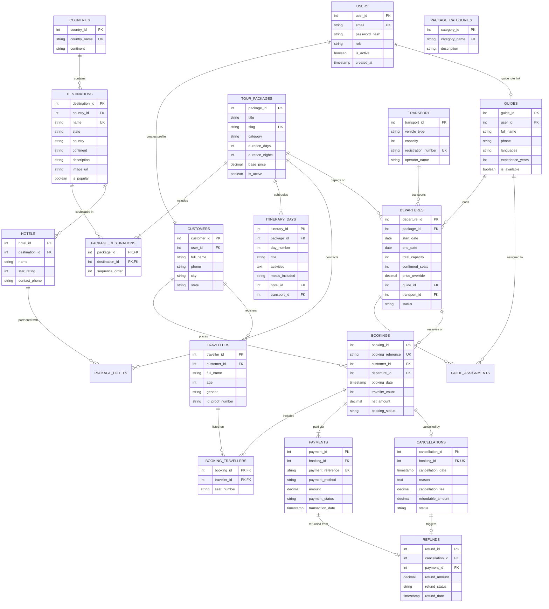

# Entity-Relationship (ER) Diagram & Schema Mapping
**Project Title:** BharatYatra — Tourism Package and Travel Booking Management System  
**Course:** Database Management Systems (PBL Project 63)

---

## 1. Visual Mermaid ER Diagram

---

## 2. Cardinality and Structural Constraints

1. **`Users` to `Customers` (1:1)**:
   - Each registered customer has exactly one system user account.
2. **`Users` to `Guides` (1:1)**:
   - Tour guides are staff members linked to a user authentication record with `role = 'Guide'`.
3. **`TourPackages` to `Destinations` (M:N)**:
   - Implemented via associative entity `PackageDestinations` with composite PK `(package_id, destination_id)` and a `sequence_order` attribute.
4. **`TourPackages` to `ItineraryDays` (1:N)**:
   - A package contains $N$ ordered days ($N \ge 1$), enforced by `UNIQUE(package_id, day_number)`.
5. **`TourPackages` to `Departures` (1:N)**:
   - A single tour package can be scheduled across multiple departure dates throughout the season.
6. **`Departures` to `Bookings` (1:N)**:
   - Multiple customers can book tickets on a single departure until `confirmed_seats = total_capacity`.
7. **`Bookings` to `Travellers` (M:N)**:
   - Captured through junction table `BookingTravellers`, allowing individual passenger seat assignments.
8. **`Bookings` to `Payments` (1:N)**:
   - Usually 1 payment per booking; supports multiple partial attempts or transaction retries.
9. **`Bookings` to `Cancellations` (1:0..1)**:
   - A booking can have at most one cancellation record (`booking_id` has UNIQUE constraint).
10. **`Cancellations` to `Refunds` (1:0..1)**:
    - Approved cancellations link directly to their corresponding payment and refund disbursement.
